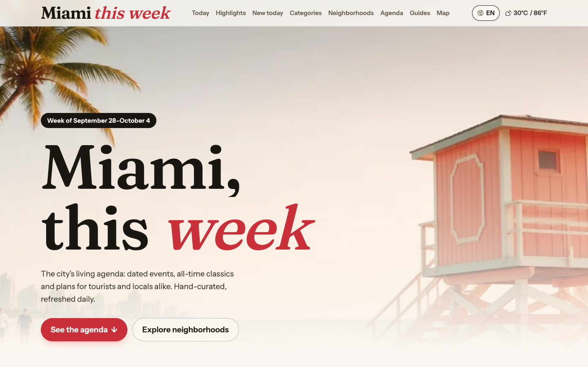
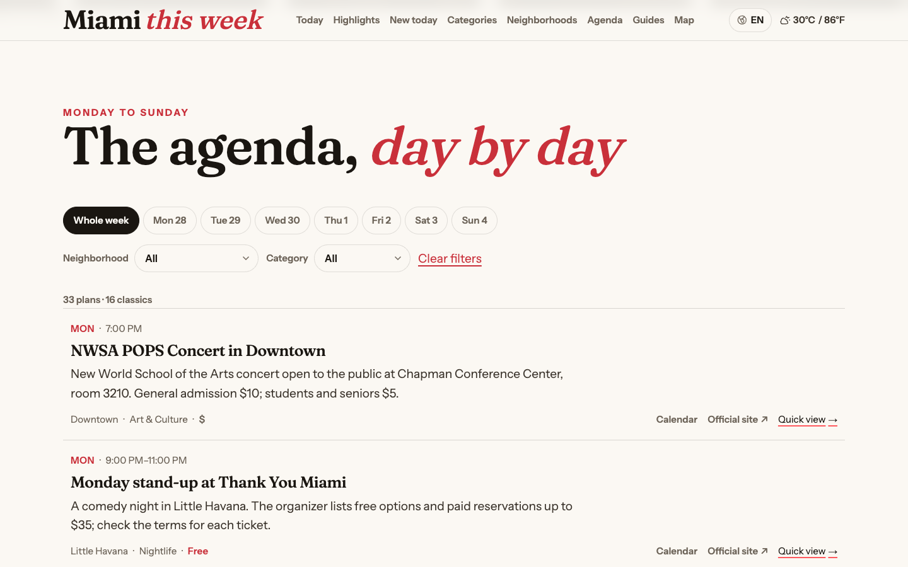
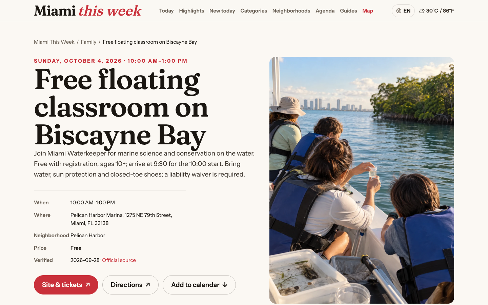
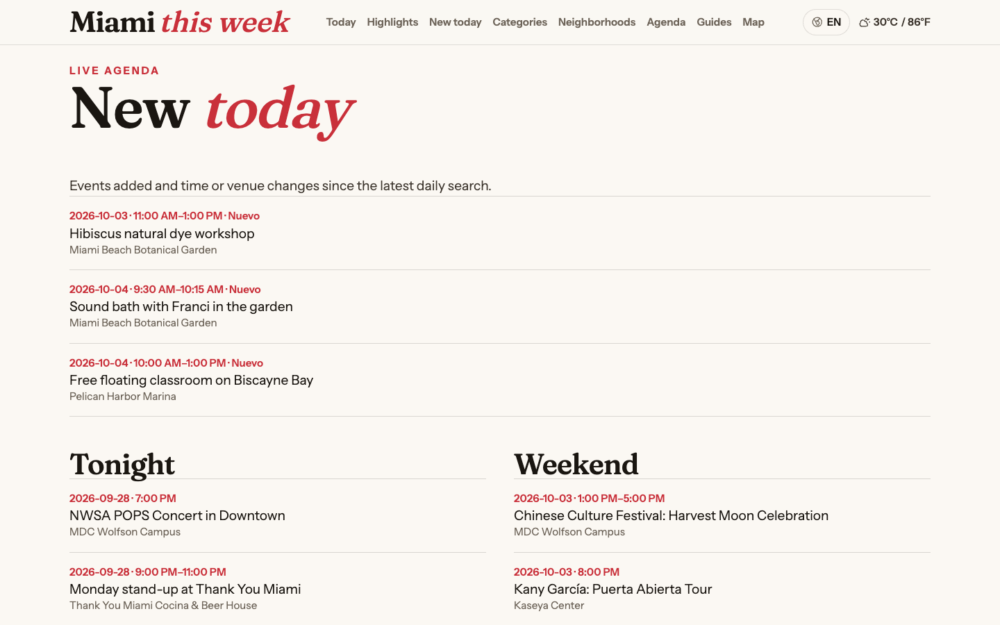
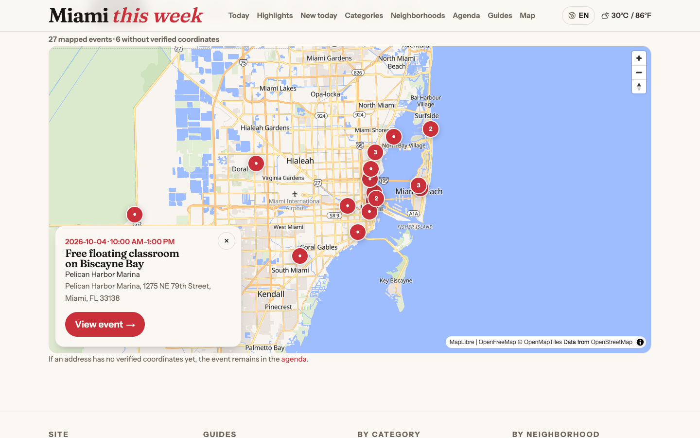
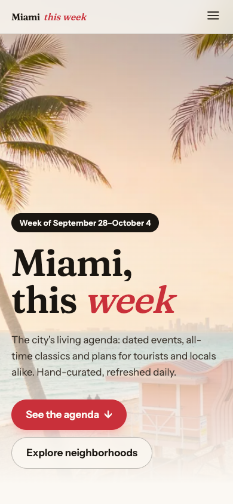
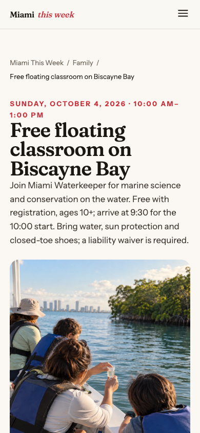
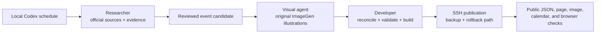

# Miami This Week

**A bilingual, source-checked guide to what to do in Miami this week.**

[Explore the live site](https://miamithisweek.com/) · [See the event map](https://miamithisweek.com/mapa/) · [How the agenda is maintained](AUTOMATION.md)

Miami This Week brings dated events and enduring local places into one Spanish-first experience with an English option. Readers can move from a weekly agenda to an event page, check the organizer's source, add the event to a calendar, or get directions. The interface is responsive across desktop and mobile.

## Explore the product

| Weekly agenda | Verified event detail |
| --- | --- |
| Day, area, and category filters keep the week scannable. | Each event shows its date, time, venue, address, price context, and source link. |
|  |  |

### New today

The live “New today” section surfaces newly checked additions and verified changes. It removes an event from the dynamic lists when it is no longer confirmed as upcoming.

### Map with a cautious pin policy

The map opens a concise event card before the full detail page. A listing stays in the agenda when its exact location cannot be confirmed; it does not receive an approximate pin.

### Designed for a phone, too

| Home | Event detail |
| --- | --- |
|  |  |

## How the content stays current

A daily local Codex heartbeat is set for **08:00 ET**. Its first observed run on **28 September 2026** found four additions, which were published and checked. A deeper Sunday heartbeat is active for **11:00 ET** and researches the *following* Monday–Sunday; it had **not yet completed its first scheduled run** when this showcase was prepared. The Mac and Codex must be available. A scheduled time alone is not proof of a successful publication.

The Researcher uses **GPT-6 Astra, xhigh** to inspect primary organizer and venue sources and maintain per-event evidence. The Visual agent uses **GPT-6 Sol, xhigh** with integrated ImageGen to produce an original illustration for each event. The exact ImageGen model version is not exposed. The Developer uses **GPT-6 Sol, xhigh** to check the data, preserve stable event identity, require full image coverage, build, publish over SSH with a backup, and verify the public result. [Read the process and its evidence limits](AUTOMATION.md).

## Dated snapshot

At the **28 September–4 October 2026** publication, the agenda held **34 dated events and 16 evergreen places**. Twenty-eight event records had verified coordinates; six remained in the agenda without pins. The live map filters ended events, so the map screenshot taken later on 28 September shows **27 currently displayed mapped events** after one noon event left the upcoming list. These are dated observations, not live counters for future weeks.

The screenshots in this repository are unedited captures of the public website with its English setting selected on 28 September 2026. One small “Nuevo” status badge remains in Spanish in the live English view; [capture details](CAPTURES.md) record that visible localization gap. Event facts, availability, prices, and the live layout can change. The application source and research ledger are maintained separately in a private repository; this public repository contains presentation material only.
